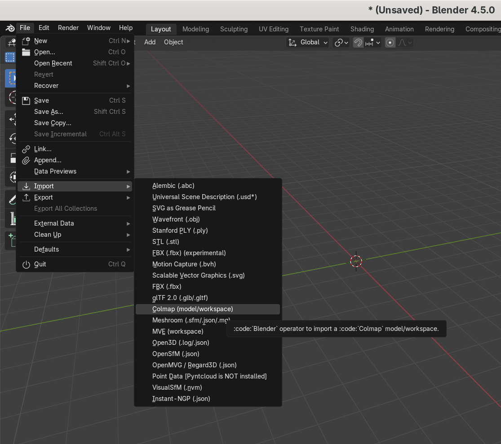
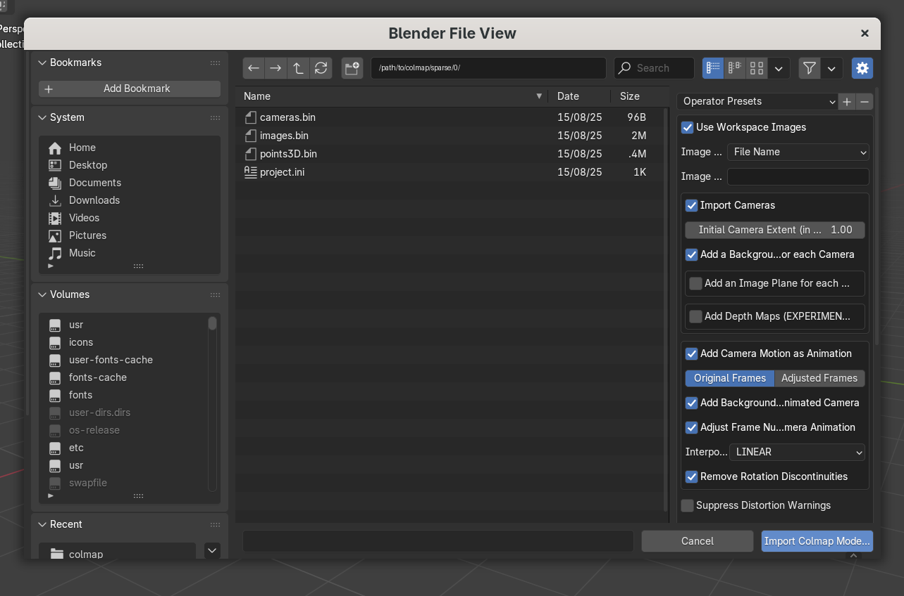
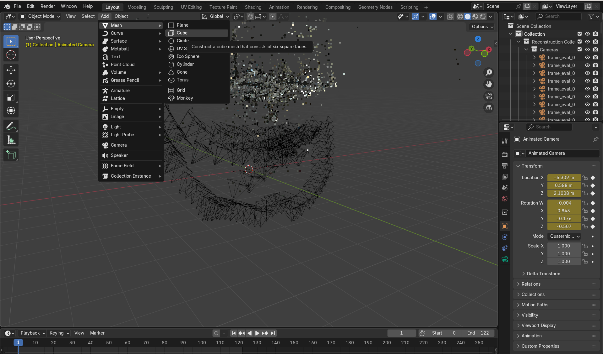
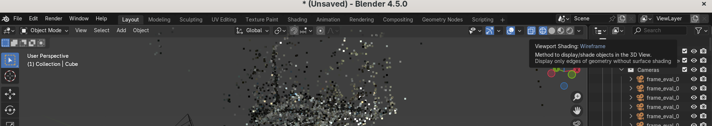
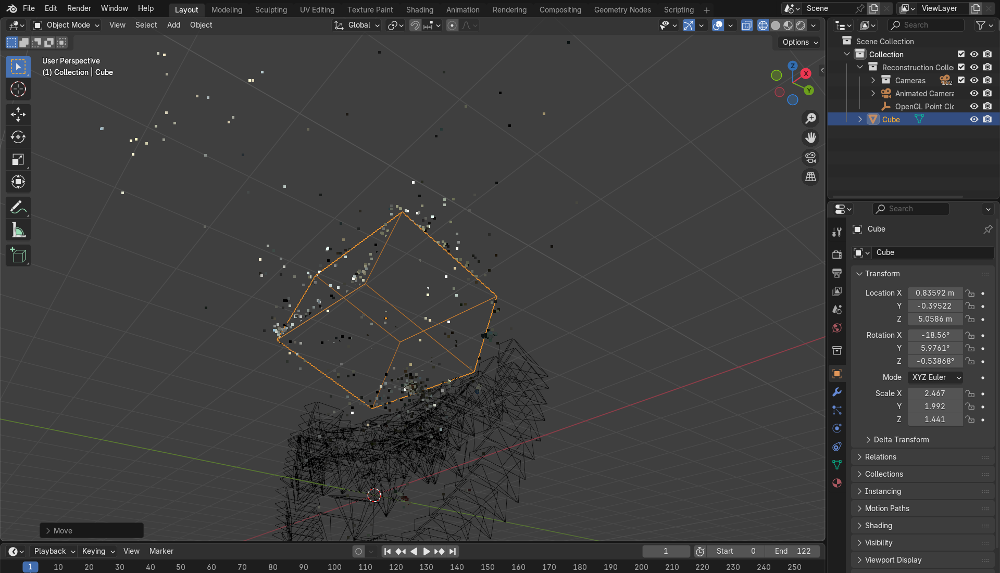

# Manual initialization for forge-sim

The method developed in this repository starts from an initial shape (a cubed-sphere in most cases) that is optimized to represent an object.
The initial pose and radius of the initial shape has a large impact on the quality on the final representation.

Here, we present the method used to manually find the pose and radius of the initial shape.

## Install Blender

Download [Blender](https://www.blender.org/download/) if it is not already on your computer.

If you are processing a real-world dataset go to [Real-World Data](#real-world-data), if you are processing a synthetic dataset go to [Synthetic Data](#synthetic-data).

## Real-World Data

### Importing a COLMAP point cloud

Follow [this tutorial](https://github.com/Schindler-EPFL-Lab/thermo-nerf/blob/main/thermo_scenes/docs/Collect_new_dataset.md#data-collection-using-a-flir-camera) to capture and process a dataset.
Install the [SBCV Blender Add-on](https://github.com/SBCV/Blender-Addon-Photogrammetry-Importer) by following the [official instructions](https://blender-photogrammetry-importer.readthedocs.io/en/latest/installation.html).
Finally, open Blender and import your COLMAP scene.



Navigate to: `/path/to/dataset/colmap/sparse/0/` and press **Import Colmap Model**.



> ⚠️ You may see warnings like *"Blender does not support radial distortion..."*. Ignore them&mdash;we will not render the point cloud in Blender.

## Synthetic Data

If you are using a synthetic model from BuildNet3D then simply import it to Blender.

## Determining the transformations

Add a cube in Blender.


Adjust the cube (translate, scale, rotate) so that it fully encloses the point cloud while excluding outliers.
- Enable *Wireframe Preview* in the **top right**, or press and hold **Z** and choose *Wireframe*.



**Controls:**

- Translate: **G**&rarr;then **X**, **Y**, or **Z** for axis constraint.
- Scale: **S**&rarr;then **X**, **Y**, or **Z** for axis constraint.
- Rotate: **R**&rarr;then **X**, **Y**, or **Z** for axis constraint.

## Saving the transformations

After positioning the cube, check its **Transform** values in the right-hand panel.



Save these values to:  `./data/bbox_transforms/name-of-your-building.json`

Use the following format:

```json
{
    "translation": [
        0.83592,
        -0.39522,
        5.0586
    ],
    "rotation": [
        -18.56,
        5.9761,
        -0.53868
    ],
    "scale": [
        2.467,
        1.992,
        1.441
    ]
}
```

Congratulations 🎉 !